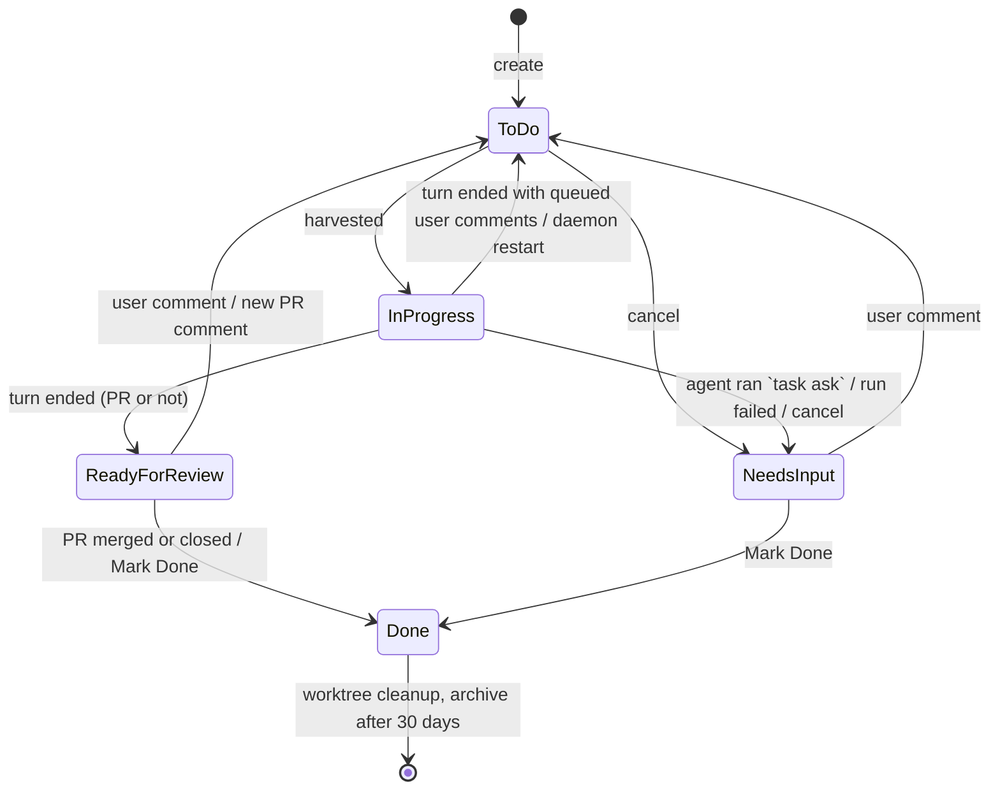

# PRD: Taskboard

## Introduction

Today every agent run in yuki-conductor starts from a chat message or a cron
task. Either way the user drives it turn by turn. The **Taskboard** lets the
user queue work instead. Each task names a project, a harness, and optionally a
worktree. The daemon picks tasks up ("harvests" them) as harness capacity
frees, runs them unattended, and moves each one through a small set of states.
The user gets a push notification only when a task needs them: it has a
question, or a PR is ready to review. PRs are followed to merge, and the
worktree is cleaned up afterwards.

The board is a web UI tab that works on mobile. The task and its comments form
one flat Markdown timeline, with Mermaid diagrams rendered by
[pele](https://github.com/obsidianmd/pele).

## Goals

- Queue coding and research work against registered projects without
  babysitting a chat.
- Run tasks unattended, never exceeding the configured concurrency for each
  harness.
- Need the user only at the two moments that matter: **Needs Input** and
  **Ready for Review**. Notify on both.
- Close the loop on PRs automatically: review comments send the task back to
  the queue, and merge or close marks it Done and cleans up.
- Let agents work with the board themselves: read their task, comment, ask
  for input, attach a PR, and spawn follow-up tasks.

## Decisions (from clarification, 2026-10-18)

| # | Decision |
|---|---|
| 1 | One task = one agent session. If resuming fails because the session is gone, start a fresh session whose prompt is the task body plus the full comment timeline. |
| 2 | Commenting on a Needs Input task moves it back to the To Do queue. It does not resume immediately. |
| 3 | Comments made while In Progress are queued and delivered when the current turn ends. |
| 4 | A turn that ends with no PR and no question goes to Ready for Review. |
| 5/6 | Every 5 min, poll PRs of Ready for Review tasks. New PR comments → To Do. Merged → Done. Closed unmerged → Done. A board comment on Ready for Review → To Do immediately. |
| 7 | Cancel moves the task to **Needs Input**, so the user's next comment steers it. There is no separate Cancelled state. |
| 8 | To Do is FIFO by default. The user can reorder it by hand. |
| 9 | Global pause stops new pickups only, and survives daemon restarts. |
| 10 | Tasks In Progress when the daemon restarts are re-queued and resume their session. |
| 11 | Sub-tasks created by agents are fire-and-forget. The parent link is shown for information only. |
| 12 | A project is required, chosen from the existing Projects registry. |
| 13 | Worktree at `<repo>/.claude/worktrees/task-<id>`, branch `task/<id>-<slug>`, based on `origin/<default-branch>`. |
| 14 | Non-worktree tasks on the same repo are not serialized. Collisions are accepted. |
| 15 | On Done, remove the worktree, the local branch and the remote branch. |
| 16 | Tasks use the harness's default model. There is no per-task model. |
| 17 | Tasks use the same permission mode as chat runs. |
| 18 | Agents act through a `yuki-conductor task …` CLI suite. |
| 19 | One single-column list on both desktop and mobile. No kanban. |
| 20 | Done tasks auto-archive after 30 days. |
| 21 | The timeline is flat with no threads. Quote-reply works on a selected text excerpt. |
| 22 | Tasks and comments support attachments. |
| 23 | Mermaid is rendered with the `pele` npm package. |
| 24 | Notifications go to web push, and to Slack if that channel is enabled. No Pushover. |

## State Machine



When a turn ends, the next state is resolved in this order (first match wins):

1. The user posted a comment during the turn → **To Do**. This holds even if
   the agent asked a question or opened a PR, because the user's newer input
   supersedes it.
2. The run was cancelled → **Needs Input**.
3. The run failed (harness error, timeout, nonzero exit) → **Needs Input**,
   with a system comment carrying the error.
4. The agent called `task ask` during the turn → **Needs Input**.
5. Otherwise → **Ready for Review**, whether or not a PR is attached.

## User Stories

### US-001: Task storage
**Description:** As a developer, I need tasks and comments persisted so the board survives restarts.

**Acceptance Criteria:**
- [ ] New `TaskStore` in the workspace DB, following the existing `store.py` patterns (lock + per-call connection)
- [ ] Table `tasks`: `id INTEGER PK`, `title`, `body`, `project`, `harness`, `use_worktree`, `status` (`todo|in_progress|needs_input|ready_for_review|done`), `sort_order`, `session_id`, `worktree_path`, `branch`, `pr_url`, `pr_checked_at`, `asked_input` (flag set by `task ask` during the current turn), `parent_task_id`, `created_at`, `updated_at`, `started_at`, `done_at`, `cleanup_error`
- [ ] Table `task_comments`: `id`, `task_id`, `author` (`user|agent|system|github`), `body`, `quote_comment_id` (nullable), `attachments` (JSON list of absolute paths), `delivered` (bool: has the agent seen it), `external_url` (for GitHub-imported comments), `created_at`
- [ ] Taskboard pause flag kept in the DB (a small KV row), so it survives restarts
- [ ] "Archived" is derived (`status='done' AND done_at < now-30d`), not stored
- [ ] Unit tests: create/list/update/reorder/comment roundtrip, plus archive filtering
- [ ] `uv run pytest` and `uv run ruff check .` pass

### US-002: Concurrency config
**Description:** As the user, I want to cap how many tasks each harness runs at once.

**Acceptance Criteria:**
- [ ] `TASKBOARD_CONCURRENCY` in `~/.yuki-conductor/.env`, e.g. `claude-code:10,pi:1`, parsed in `config.py`
- [ ] Defaults: `claude-code` 10, `pi` 1, any other harness 1. An unlisted harness gets its default.
- [ ] Invalid values fail at startup with a clear message, matching how `HARNESSES` is validated
- [ ] Documented in CLAUDE.md
- [ ] Tests for parsing and defaults

### US-003: Harvester
**Description:** As the user, I want queued tasks to start automatically whenever a harness has a free slot.

**Acceptance Criteria:**
- [ ] `taskboard.py` runs a harvester thread, started by `runtime.start()` alongside cron
- [ ] It wakes on a short interval (≤2s) and immediately on any task mutation
- [ ] It does nothing while paused. Running tasks are unaffected by a pause.
- [ ] It walks To Do in `sort_order` and starts each task whose harness is enabled and below its concurrency cap. A task whose harness is busy doesn't block tasks for other harnesses.
- [ ] A To Do task whose harness is disabled (not in `HARNESSES`) is skipped and flagged in the UI ("harness not enabled on this machine"). It is never run.
- [ ] Each picked task runs on its own worker thread: status → In Progress, `started_at` set
- [ ] At startup, every In Progress task is moved to the **top** of To Do and gets a system comment ("re-queued after daemon restart")
- [ ] Tests with a fake harness: the cap is honored per harness, pause blocks pickup, restart re-queues

### US-004: Running a task turn
**Description:** As the user, I want each pickup to run one agent turn in the right directory with the right context.

**Acceptance Criteria:**
- [ ] Worktree tasks: the first pickup runs `git fetch origin`, then `git worktree add <repo>/.claude/worktrees/task-<id> -b task/<id>-<slug> origin/<default-branch>`. The default branch comes from `git symbolic-ref refs/remotes/origin/HEAD`. Later pickups reuse the stored `worktree_path`.
- [ ] If worktree creation fails → Needs Input with the git error as a system comment
- [ ] Non-worktree tasks run with the project path as cwd
- [ ] Runs use `harness.process.run_agent` with `conversation_key=task:<id>` (so cancel works) and the harness default model
- [ ] First-turn prompt: task title, body, and any existing comments. Attachments are passed as `<attachment>` tags.
- [ ] Later turns resume `session_id`. The prompt holds only the undelivered comments, quoted excerpts included.
- [ ] If resuming fails because the session no longer exists, retry once with a fresh session and the full-context prompt (title + body + whole timeline), then store the new `session_id`
- [ ] Every comment included in a prompt is marked `delivered`
- [ ] The agent's final response text becomes an `agent` comment, with its attachments split out
- [ ] The next state is resolved by the precedence list in the State Machine section
- [ ] A PR URL (`https://github.com/<o>/<r>/pull/<n>`) found in the final text is recorded as a fallback when `task pr` wasn't called
- [ ] Tests cover each resolution branch and the session-gone fallback

### US-005: Taskboard system prompt and env
**Description:** As an agent, I need to know I'm working on a task and how to talk to the board.

**Acceptance Criteria:**
- [ ] `skills.system_prompt()` / `core_prompt()` accept a `task_id` and render a "Taskboard" section. It states the task id and that the run is unattended, and it says:
  - when blocked, use `task ask`; don't wait for a reply in-turn;
  - when a PR is opened, register it with `task pr`;
  - progress goes in `task comment`;
  - anything posted to GitHub (PR body, comments, review replies) must end with the agent attribution line and the `<!-- yuki-conductor:agent -->` marker;
  - the final response becomes a comment on the task.
- [ ] The run gets `YUKI_TASK_ID` in its env, so the CLI defaults to the current task
- [ ] Task runs do **not** get a `push_conversation_id`. Pushes don't belong to the task.
- [ ] Tests assert the section appears only when `task_id` is given, on both prompt builders

### US-006: `yuki-conductor task` CLI suite
**Description:** As an agent (or the user in a shell), I want commands to work with the board.

**Acceptance Criteria:**
- [ ] Every subcommand talks to the daemon over HTTP, like `send` does, so all mutations go through one process
- [ ] `task show [ID]`: title, status, metadata, body, and the full timeline as Markdown
- [ ] `task list [--status S] [--project P]`
- [ ] `task comment [ID] [--quote COMMENT_ID] [--attach PATH]... "text"`: adds an `agent` comment when `YUKI_TASK_ID` is set, otherwise a `user` comment
- [ ] `task ask [ID] "question"`: posts the question as an agent comment and sets `asked_input`
- [ ] `task pr [ID] URL`: records `pr_url`
- [ ] `task create --project P [--harness H] [--worktree] [--title T] "body"`: harness defaults to the default harness. When run inside a task, the new task's `parent_task_id` is set to that task.
- [ ] `ID` defaults to `$YUKI_TASK_ID`. A clear error is raised when neither is given.
- [ ] Tests via the existing simulate/CLI test patterns

### US-007: Taskboard skill
**Description:** As an agent, I want a skill that documents the task CLI so I use it correctly.

**Acceptance Criteria:**
- [ ] `plugins/yuki-conductor/skills/yuki-conductor-task/SKILL.md` is in the bundled plugin, so it's advertised everywhere. This lets a chat session also create tasks.
- [ ] The description covers reading the current task, commenting and quote-replying, asking for input, registering a PR, and creating follow-up tasks
- [ ] The body gives concrete examples of each command, the "ask, then end your turn" rule, and the GitHub attribution footer (see Technical Considerations)
- [ ] The skill has no personal information

### US-008: Task HTTP API
**Description:** As the frontend and CLI, I need endpoints for all board operations.

**Acceptance Criteria:**
- [ ] `GET /api/tasks?archived=0|1`: list in display order, with comment counts and the latest-activity time
- [ ] `POST /api/tasks`: create. Validates the project exists in `ProjectStore` and the harness is enabled.
- [ ] `GET /api/tasks/{id}`: task plus timeline
- [ ] `PATCH /api/tasks/{id}`: edit title/body/project/harness/worktree. Returns **409 unless status is To Do and `session_id` is null** (never picked up).
- [ ] `POST /api/tasks/{id}/comments`: adds a comment and applies the requeue rules (US-010)
- [ ] `POST /api/tasks/{id}/cancel`: from In Progress, kills the run via `cancel_process("task:<id>")`; from To Do, takes it off the queue. Either way the status → Needs Input.
- [ ] `POST /api/tasks/{id}/done`: allowed from Needs Input or Ready for Review. Triggers cleanup.
- [ ] `POST /api/tasks/reorder`: new `sort_order` for To Do ids
- [ ] `GET/PUT /api/taskboard/state`: `{paused, running: {harness: n}, limits: {harness: n}}`
- [ ] `GET /api/tasks/{id}/steps`: replays buffered live steps (see US-012)
- [ ] Every mutation broadcasts a `{"type": "task", "id": …}` WebSocket event so open views refresh
- [ ] Each endpoint has API tests

### US-009: Notifications
**Description:** As the user, I want a ping when a task needs me, without being pinged otherwise.

**Acceptance Criteria:**
- [ ] On entering **Needs Input** (agent asked, run failed, or restart failure) and **Ready for Review**: send a web push and, if the Slack channel is enabled, a Slack message via `send_notification`
- [ ] No notification on Done, To Do, In Progress, or a user-initiated cancel
- [ ] Web push payload carries the task id. The service worker opens `#tasks/<id>` on click. `web_push.notify` is generalized to take a URL/target rather than only a conversation id.
- [ ] Text reads `[Task #12 · Needs Input] <title>` with the excerpt of the latest agent comment. Ready for Review includes the PR URL.
- [ ] Tests assert which transitions notify

### US-010: Comment-driven requeue
**Description:** As the user, I want my comments to put the task back to work.

**Acceptance Criteria:**
- [ ] User comment on **Needs Input** or **Ready for Review** → To Do immediately, at the **end** of the queue
- [ ] User comment on **In Progress** → stored undelivered. At turn end the task goes to To Do per the precedence rules.
- [ ] User comment on **To Do** → stored. It's delivered on pickup with no status change.
- [ ] User comment on **Done** → stored only. Done is terminal and is never reopened.
- [ ] A system comment records each automatic transition ("Moved to To Do: new comment")

### US-011: PR watcher
**Description:** As the user, I want merged PRs to close tasks and review comments to restart them.

**Acceptance Criteria:**
- [ ] Every 5 minutes, for each Ready for Review task with a `pr_url`, run `gh pr view <url> --json state,mergedAt,comments,reviews` and fetch review comments via `gh api repos/{o}/{r}/pulls/{n}/comments`
- [ ] New = `created_at > pr_checked_at` and the body does **not** contain the agent marker `<!-- yuki-conductor:agent -->`. Filtering is by marker, not author, because the agent may post as the user's own GitHub account.
- [ ] New comments are imported as `github` comments, with author, body, and `external_url`. Inline review comments include `path:line`. Then the task → To Do.
- [ ] `MERGED` → Done. `CLOSED` → Done, with a system comment noting it wasn't merged.
- [ ] `gh` errors are logged and leave the task untouched (retry next tick)
- [ ] Tests with a mocked `gh`

### US-012: Live steps for In Progress tasks
**Description:** As the user, I want to watch what the agent is doing, like in chat.

**Acceptance Criteria:**
- [ ] `on_event` from `run_agent` feeds a step buffer keyed `task:<id>`, reusing `ConnectionManager.add_step` and broadcast
- [ ] The buffer is memory-only, matching chat. It's cleared when the turn ends.
- [ ] The task detail view shows the live step stream while In Progress, using the chat's existing step components
- [ ] Reopening the view mid-run replays the buffer via `/api/tasks/{id}/steps`

### US-013: Done cleanup
**Description:** As the user, I want finished worktree tasks to leave nothing behind.

**Acceptance Criteria:**
- [ ] On Done for a worktree task, run `git worktree remove --force <path>`, `git branch -D <branch>`, then `git push origin --delete <branch>`
- [ ] "Remote branch already deleted" is treated as success
- [ ] Any other failure is stored in `cleanup_error` and shown on the task. The task stays Done, and a "Retry cleanup" action is offered.
- [ ] Tests with a temp git repo and a bare "origin"

### US-014: Tab layout
**Description:** As the user, I want Tasks as the second tab.

**Acceptance Criteria:**
- [ ] The tab bar is Chat, **Tasks**, Automations, `⋯`
- [ ] `projects` moves into `OVERFLOW_TABS`, alongside sessions, status and plugins
- [ ] Deep links `#tasks` and `#tasks/<id>` work. `#projects` still works.
- [ ] CLAUDE.md "Web tabs" section updated
- [ ] Verify in browser using the playwright-cli skill

### US-015: Task list view
**Description:** As the user, I want one scannable list of tasks that works on my phone.

**Acceptance Criteria:**
- [ ] A single column at every width. On desktop, a list/detail split like Automations. On mobile, the list and detail are separate screens.
- [ ] Status filter pills with counts: All active · To Do · In Progress · Needs Input · Ready for Review · Done. "All active" (everything but Done) is the default.
- [ ] Rows show title, status badge, project, harness icon, a worktree/PR indicator, and relative time of latest activity
- [ ] "All active" orders rows by status (Needs Input, Ready for Review, In Progress, To Do), then `sort_order` within To Do
- [ ] To Do rows can be reordered by a drag handle, touch included, and by a "Move to top" row action
- [ ] A header **pause/resume** toggle shows running/limit per harness, e.g. `claude-code 3/10 · pi 1/1`. While paused, a "Paused — no new tasks will start" banner shows.
- [ ] A "Show archived" toggle reveals Done tasks older than 30 days
- [ ] Usable at a 375px width: no horizontal scroll, and tap targets ≥ 44px
- [ ] Verify in browser using the playwright-cli skill, at desktop and mobile viewports

### US-016: Create and edit task
**Description:** As the user, I want to create a task and fix it before it's picked up.

**Acceptance Criteria:**
- [ ] A "New task" form with: title (required), body (Markdown, with a Preview tab), project (picker from the Projects registry, required), harness (toggle of enabled harnesses, default preselected), worktree (checkbox, default **on**), and attachments (via `/api/uploads`)
- [ ] Edit reuses the same form. It's available only when status is To Do and the task was never picked up. Otherwise the button is hidden.
- [ ] Verify in browser using the playwright-cli skill

### US-017: Task detail, timeline and composer
**Description:** As the user, I want to read the task and talk to the agent in one place.

**Acceptance Criteria:**
- [ ] The header shows title, status, project, harness, branch, PR link, parent task link, child task links, and `cleanup_error` if any
- [ ] Actions follow state: Edit (US-016), Cancel (To Do / In Progress), Mark Done (Needs Input / Ready for Review), Retry cleanup
- [ ] Body and comments are rendered with the shared Markdown component (US-018)
- [ ] The timeline is flat and chronological. Authors are visually distinct: user, agent (harness icon), GitHub (avatar + link), and system (small muted line).
- [ ] **Quote reply:** selecting text inside a comment or the body shows a floating "Quote" button. It inserts `> excerpt` lines into the composer and sets `quote_comment_id`. On mobile it uses the selection, with a long-press fallback "Quote whole comment" action.
- [ ] A quoted comment links back to its source (scroll + highlight)
- [ ] The composer supports Markdown, attachments, and Cmd/Ctrl+Enter to send. After sending, the view reflects the new status (e.g. "Queued — will be delivered when the current turn ends").
- [ ] Verify in browser using the playwright-cli skill

### US-018: Markdown + Mermaid rendering
**Description:** As the user, I want diagrams in tasks and comments to render.

**Acceptance Criteria:**
- [ ] Add the `pele` npm dependency
- [ ] A shared `web/src/Markdown.tsx` (react-markdown + remark-gfm). Fenced ```` ```mermaid ```` blocks render through `pele`'s `mount()` (fits the container width).
- [ ] On a parse error, show the raw code block plus the error message. The page must not break.
- [ ] Map the `--pele-*` CSS variables to the app's theme variables, so light and dark both work
- [ ] Verify in browser using the playwright-cli skill, with a flowchart and a sequence diagram

## Functional Requirements

- FR-1: A task has exactly one status from: To Do, In Progress, Needs Input, Ready for Review, Done.
- FR-2: A task requires a title, a registered project, and an enabled harness. Worktree use is a per-task flag.
- FR-3: The harvester never runs more tasks per harness than `TASKBOARD_CONCURRENCY` allows.
- FR-4: The global pause stops new pickups only. It persists across restarts.
- FR-5: Pickup order is To Do `sort_order`. New and re-queued tasks append to the end. Restart-recovered tasks go to the top.
- FR-6: A task is editable only while To Do and never picked up.
- FR-7: Cancel stops any running turn and moves the task to Needs Input.
- FR-8: User comments re-queue Needs Input and Ready for Review tasks immediately. Comments made on In Progress tasks are delivered when the turn ends.
- FR-9: State after a turn follows the precedence list in the State Machine section.
- FR-10: Needs Input and Ready for Review transitions notify via web push, plus Slack when enabled.
- FR-11: PRs on Ready for Review tasks are polled every 5 minutes. New external comments re-queue the task. Merge or close marks it Done.
- FR-12: Done worktree tasks have their worktree, local branch and remote branch removed.
- FR-13: Done tasks older than 30 days are hidden by default.
- FR-14: Agents interact through `yuki-conductor task …`, documented by a bundled skill. Task runs get a Taskboard system-prompt section and `YUKI_TASK_ID`.
- FR-15: Task and comment bodies render Markdown, with Mermaid via `pele`, and support attachments.
- FR-16: If a session can't be resumed, a fresh session is started with the full task context.

## Non-Goals

- No kanban/column board. The single list is the only layout.
- No per-task model selection, priorities, labels, due dates, or assignees.
- No dependencies or blocking between tasks. The parent/child link is informational.
- No per-project serialization of non-worktree tasks.
- No threaded replies, comment editing, or reactions.
- No injection of comments into a turn that's still running.
- No Slack-side task creation or commenting. Slack only receives notifications.
- No Pushover integration.
- No reopening Done tasks. A comment on a Done task is stored only.
- No automatic retry of failed runs. A failed run goes straight to Needs Input.
- No hard delete of tasks. Mark Done is the only way to close one.
- No persistence of live step streams after a turn ends. The final response is persisted as a comment.
- No change to how chat renders Markdown. Chat may adopt the shared component later.

## Design Considerations

- Mirror `AutomationsView` for the list/detail split and reuse its sidebar styling, so the app stays consistent.
- Status colours: To Do = neutral, In Progress = accent with a subtle pulse, Needs Input = amber, Ready for Review = green, Done = muted.
- Reuse the chat's step rendering components for the live stream and the harness icons from the conversation list.
- Mobile: the filter pills scroll horizontally if they overflow, which is the only allowed horizontal scroll. The composer sticks to the bottom. The quote button floats above the selection.

## Technical Considerations

- **New module** `src/yuki_conductor/taskboard.py` owns the harvester, the turn runner, transitions, the PR watcher and cleanup. `TaskStore` goes in `store.py` or a sibling `task_store.py`. All transitions go through one `transition(task, new_status, reason)` function that writes the system comment, broadcasts, and notifies. This makes the rules testable in one place.
- **Session-gone detection** is harness-specific. Claude Code reports `No conversation found with session ID`, and pi's equivalent must be checked against a real run. Add a `session_missing` flag to `RunResult`, set by each parser.
- **Cancel** reuses `harness.process.cancel_process` with the `task:<id>` key. The runner checks `was_cancelled` to pick Needs Input.
- **Restart** (`POST /api/daemon/restart`) kills running tasks. US-003's startup recovery handles them.
- **Agent-authored GitHub text**: the agent may share the user's GitHub account, so authorship can't tell comments apart. The system prompt (US-005) and the skill (US-007) therefore require every PR description, PR comment and review reply the agent posts to end with a visible line `_🤖 Posted by yuki-conductor agent (task #<id>)_` followed by the hidden marker `<!-- yuki-conductor:agent -->`. The PR watcher ignores comments containing the marker.
- `.claude/worktrees/` must be ignored by each target repo. Check this, and when it isn't ignored add it to `.git/info/exclude` at worktree creation rather than editing the repo's `.gitignore`.
- The CLI talks to the daemon at `WEB_HOST:WEB_PORT`, like `send`. It fails clearly when the daemon isn't running.
- No backward-compatibility code is needed. New tables only.
- Tests must not touch the real workspace DB. Add an autouse fixture like `isolated_cron_run_store`.

## Success Metrics

- A task can be created on a phone in under 30 seconds.
- Zero tasks stuck In Progress after a daemon restart.
- Concurrency never exceeds the configured limit (asserted in tests).
- Every merged PR's task reaches Done with its worktree and branches gone within about 5 minutes.
- The user is notified only on Needs Input and Ready for Review.

## Resolved Questions (2026-10-18)

1. A comment on a Done task does **not** reopen it.
2. Re-queued tasks go to the **end** of To Do.
3. Agent-posted GitHub text carries an attribution line plus a hidden marker, and the PR watcher ignores comments that contain the marker.
4. Failed runs are **not** retried. They go straight to Needs Input.
5. Tasks can't be deleted. They can only be marked Done.
